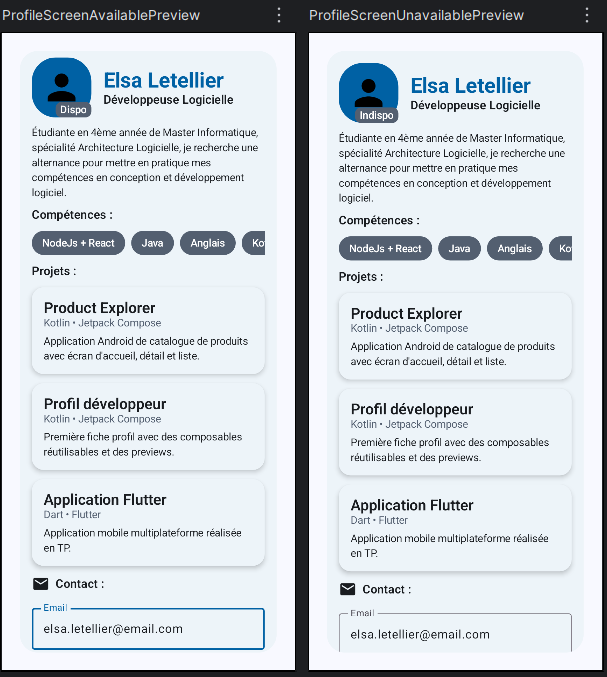
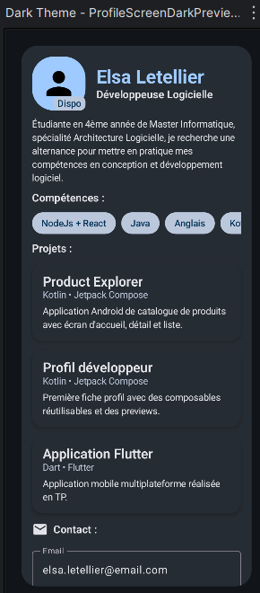

# Profil développeur Compose – Version 2

## Description courte

Cette application Android affiche le profil d'une développeuse sur un seul écran. C'est une évolution de la première fiche profil.
On y trouve un avatar, le nom, le rôle, une courte description, une liste de compétences, une liste de projets et une zone de contact avec la disponibilité et un bouton "Contacter".
Les données sont locales et écrites directement dans le code Kotlin. Les clics appellent des callbacks vides.

## Composants Compose utilisés

- Text : nom, rôle, description, titres de sections, bannière de disponibilité
- Button : bouton "Contacter" (ActionButton)
- Icon : icône Email à côté du titre "Contact :"
- Image : avatar placeholder (icône Person)
- Card : ProjectCard
- OutlinedTextField en lecture seule : email (ContactField)

## Layouts utilisés

- Column : nom et rôle, contenu des cartes projet
- Row : avatar à côté du nom et du rôle (ProfileHeader), icône à côté du titre "Contact :"
- Box : avatar avec un badge "Dispo" / "Indispo" superposé (ProfileAvatar)
- Spacer : espaces dans le header et les cartes
- Surface : la fiche (ProfileCard), l'avatar, le badge et les compétences (SkillItem)

## Listes avec LazyColumn et LazyRow

Le contenu de la fiche (ProfileCard) est une LazyColumn. Les éléments fixes sont ajoutés avec item { } et les projets avec items(projects, key = { it.id }), chaque projet étant affiché par le composable réutilisable ProjectCard.
Les compétences sont affichées dans une LazyRow qui défile horizontalement, avec le composable réutilisable SkillItem pour chaque compétence.
"Lazy" veut dire que Compose ne compose que les éléments visibles à l'écran, puis les suivants au fur et à mesure du scroll.
ProjectCard et SkillItem reçoivent leurs données en paramètres : la liste se contente de les appeler pour chaque élément, ce qui évite la duplication de code.

## Choix du thème

Le thème ProfileDevTheme définit un colorScheme bleu pour le mode clair et un colorScheme adapté pour le mode sombre. Les couleurs dynamiques d'Android 12 ont été retirées pour garder la même identité visuelle sur tous les téléphones.
Une typographie personnalisée (ProfileTypography) et des formes arrondies (ProfileShapes) sont utilisées via MaterialTheme.colorScheme, MaterialTheme.typography et MaterialTheme.shapes.
Les couleurs écrites en dur de la bannière de disponibilité ont été remplacées par les couleurs du thème (primary, error et background) pour rester lisibles en clair comme en sombre.
Trois previews : disponible, indisponible et thème sombre.

## Captures

Previews en thème clair (disponible / indisponible) :

Preview en thème sombre :

## Quelles notions du chapitre Compose UI avez-vous réutilisées dans cette application ?

J'ai réutilisé les composants fondamentaux (Text, Button, Icon, Image, Card, OutlinedTextField), les layouts (Column, Row, Box, Spacer, Surface), les listes modernes avec LazyColumn et LazyRow et des cartes réutilisables (ProjectCard, SkillItem). J'ai découpé l'écran en hiérarchie : l'écran contient une fiche, la fiche contient des sections (en-tête, compétences, projets, contact) et chaque section contient des composants plus petits. J'ai aussi appliqué Material Design 3 avec un thème personnalisé (couleurs, typographie, formes) et un rendu clair / sombre.
